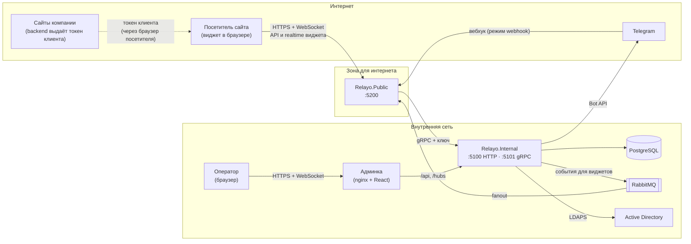
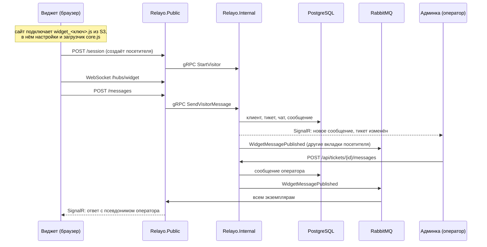
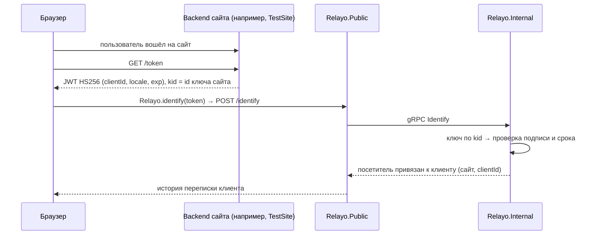
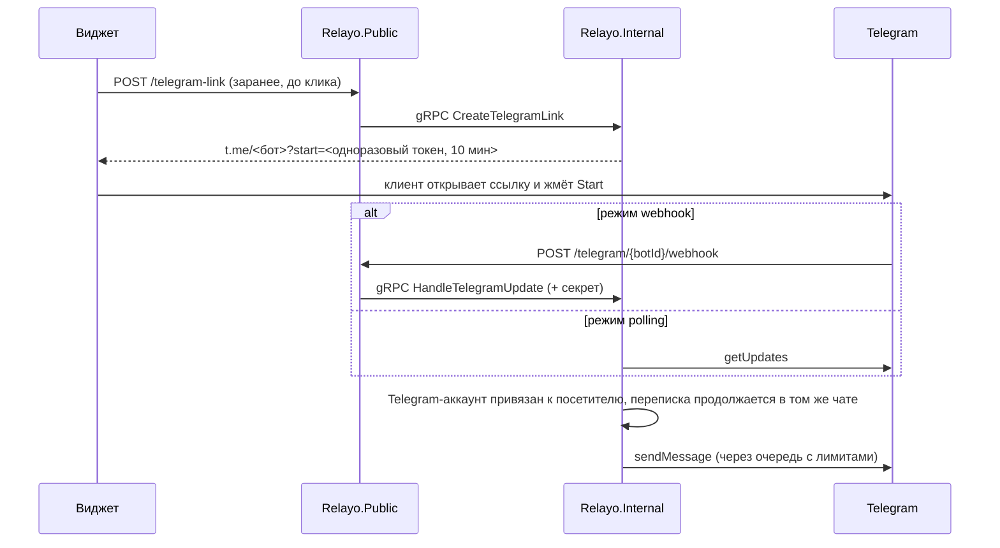
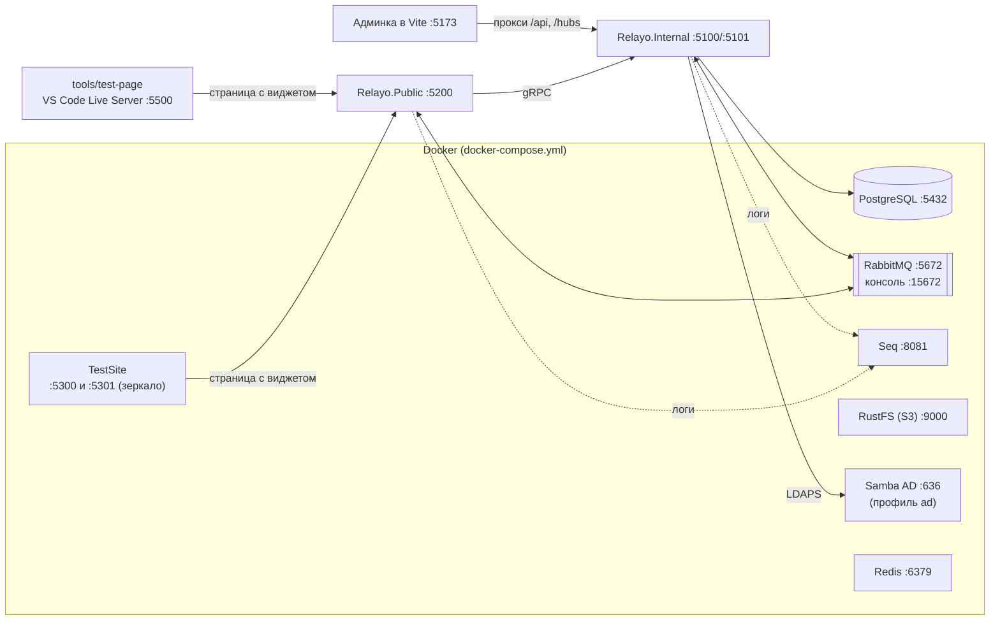

# Архитектура Relayo: компоненты и связи

Документ описывает, из каких частей состоит Relayo, какую роль выполняет каждая и как они связаны между собой.
Отдельно описаны компоненты для разработки и проверки, включая тестовый сайт.

Связанные документы: [техническое задание](../relayo-tz.md), [развёртывание](deployment.md), [README](../README.md).

## 1. Коротко

Relayo — система поддержки одной компании. Клиенты пишут из веб-виджета на сайтах компании и из Telegram,
операторы отвечают в админке.

Система разделена на две зоны:

- **внутренняя сеть** — данные, бизнес-логика и админка: `Relayo.Internal`, PostgreSQL, RabbitMQ, админка;
- **зона, доступная из интернета** — только `Relayo.Public`. Он обслуживает виджет и вебхуки и **не имеет доступа к БД**:
  читает и меняет данные только через внутренний сервис.

Если публичный сервис взломают, у атакующего не будет ни базы, ни паролей к ней, ни ключей шифрования.

## 2. Общая схема

Стрелка показывает, кто устанавливает соединение.

## 3. Компоненты

### 3.1. Сервисы

| Компонент | Роль | С кем связан |
|---|---|---|
| **Relayo.Internal** (`src/Relayo.Internal`) | Центр системы. API админки, вся бизнес-логика, работа с БД, движок правил, публикация виджетов в S3, вызовы Telegram Bot API, синхронизация и вход через AD | PostgreSQL, RabbitMQ, S3, админка, Relayo.Public (принимает gRPC), Telegram, AD |
| **Relayo.Public** (`src/Relayo.Public`) | Всё, к чему обращаются из интернета: API и realtime виджета, раздача скрипта виджета `core.js`, вебхуки Telegram | Relayo.Internal (gRPC), RabbitMQ, браузеры посетителей, Telegram |
| **Админка** (`web/admin`) | Рабочее место операторов и настройки для администратора. React SPA | Relayo.Internal через `/api` и `/hubs` |
| **Виджет** (`web/widget`) | Окно чата на сайтах компании. Preact в Shadow DOM, ~28 КБ gzip. Сайт подключает опубликованный файл `widget_<ключ>.js` из S3, тот — ядро `core.js` с публичного сервиса | S3 (файл виджета), Relayo.Public |

**Relayo.Internal** слушает два порта:
- **5100** — HTTP API админки (`/api/...`) и realtime операторов (SignalR, `/hubs/operators`);
- **5101** — gRPC для публичного сервиса (HTTP/2). Каждый вызов проверяется по общему ключу в заголовке `x-relayo-internal-key`.

Фоновые задачи внутри Relayo.Internal:

| Задача | Что делает |
|---|---|
| `DatabaseInitializer` | При запуске применяет миграции, создаёт секции таблицы сообщений, первого администратора, в Development — тестовый сайт |
| `MessagePartitionMaintenance` | Раз в 6 часов создаёт секции сообщений на следующие месяцы |
| `DirectorySyncScheduler` | Раз в минуту проверяет, не пора ли синхронизировать папку AD (интервал — в настройках LDAP) |
| `TelegramUpdatesService` | В режиме `polling` забирает сообщения у Telegram; в режиме `webhook` при запуске регистрирует вебхуки ботов |
| Очередь `telegram-outgoing` (Wolverine) | Отправляет сообщения в Telegram с соблюдением лимитов (30 в секунду на бота, 1 в секунду на чат). Хранится в PostgreSQL и переживает перезапуск |
| Очередь `rules` (Wolverine) | Движок правил: события тикетов (сообщение клиента, ответ оператора, назначение, закрытие, смена статуса) и таймеры «не ответил N минут» (отложенные сообщения в PostgreSQL). Действия правил новых событий не порождают; не больше 3 автоответов на тикет в час; каждое срабатывание пишется в журнал |
| `TestWidgetsPublisher` | Только Development: публикует тестовые виджеты в S3, если их ещё не публиковали |

**Relayo.Public** держит небольшие кэши, чтобы не ходить во внутренний сервис на каждый запрос:
- настройки виджета — 30 секунд (для проверок на сервере и прямого подключения без S3);
- список доменов всех сайтов для CORS — обновляется раз в минуту.

Оформление виджета на сайтах берётся из опубликованного файла, поэтому оно меняется по кнопке **Publish**,
а не сразу после сохранения. Новые домены сайтов доходят до публичного сервиса примерно за минуту.

### 3.2. Общие библиотеки

| Библиотека | Роль | Кто использует |
|---|---|---|
| **Relayo.Core** (`src/Relayo.Core`) | Предметная область и данные: сущности, сервисы (тикеты, клиенты, виджеты, Telegram, AD, правила), EF Core и миграции | Только Relayo.Internal |
| **Relayo.Contracts** (`src/Relayo.Contracts`) | Контракты между сервисами: gRPC (`Protos/internal_gateway.proto`) и сообщения шины | Оба сервиса |
| **Relayo.ServiceDefaults** (`src/Relayo.ServiceDefaults`) | Общая обвязка: чтение `.env`, проверка настроек при запуске, логи (Serilog, Seq), трассировка (OpenTelemetry), health checks, работа за reverse proxy, маскирование токенов в трассировке | Оба сервиса |

Relayo.Public не ссылается на Relayo.Core. Это проверяет автотест: в зависимостях публичного сервиса не должно быть
ни Core, ни EF Core, ни драйвера PostgreSQL.

### 3.3. Инфраструктура

| Компонент | Роль | Статус |
|---|---|---|
| **PostgreSQL 18** | Все данные: пользователи, сайты, виджеты, клиенты, тикеты, сообщения, боты, правила, настройки AD. Схема `wolverine` — очереди и outbox Wolverine | Используется |
| **RabbitMQ 4.3** | Шина между сервисами: события для виджетов (fanout на все экземпляры публичного сервиса) и служебные сообщения | Используется |
| **Seq** | Логи и трассировка | Необязателен |
| **Redis** | Backplane SignalR для нескольких экземпляров внутреннего сервиса, статусы операторов | Пока не используется |
| **S3 (MinIO; локально RustFS)** | Файлы виджетов `widget_<ключ>.js` и версии `widget_<ключ>.v<N>.js` (бакет `relayo-widgets`, чтение файлов виджетов открыто всем). Позже — вложения и выгрузки | Используется для виджетов |

### 3.4. Внешние системы

| Система | Связь с Relayo |
|---|---|
| **Сайты компании** | Подключают виджет одной строкой `<script>`. Backend сайта подписывает токен клиента ключом сайта (HS256), чтобы Relayo знал, кто пишет (п. 3.3.1 ТЗ) |
| **Telegram** | Relayo.Internal вызывает Bot API (отправка, `getUpdates`, регистрация вебхука). Входящие сообщения: в режиме `webhook` Telegram шлёт их на Relayo.Public, в режиме `polling` их забирает Relayo.Internal |
| **Active Directory** | Relayo.Internal читает папку (OU) служебной учёткой для синхронизации и проверяет пароль оператора при входе (LDAP bind). Только LDAPS или StartTLS |

## 4. Каналы связи

| Откуда → куда | Протокол | Защита | Что передаётся |
|---|---|---|---|
| Браузер посетителя → S3 (через прокси) | HTTPS | Только чтение файлов `widget_*` | Файл виджета с настройками и загрузчиком |
| Relayo.Internal → S3 | S3 API | Ключи доступа (`S3_ACCESS_KEY`) | Публикация файлов виджетов |
| Браузер посетителя → Relayo.Public | HTTPS, WebSocket (SignalR `/hubs/widget`) | Проверка Origin по доменам сайта, лимит запросов на IP, токен посетителя в заголовке `X-Relayo-Visitor` | Настройки виджета, сообщения, история, ссылка на Telegram |
| Relayo.Public → Relayo.Internal | gRPC (HTTP/2), порт 5101 | Общий ключ `INTERNAL_GRPC_KEY`, сетевая изоляция | Все операции виджета и вебхуки Telegram |
| Relayo.Internal → RabbitMQ → Relayo.Public | AMQP | Отдельный пользователь RabbitMQ у публичного сервиса | Новые сообщения для открытых виджетов (`WidgetMessagePublished`) |
| Relayo.Public → RabbitMQ → Relayo.Internal | AMQP | То же | Служебное `PublicServiceStarted` (экземпляр запустился) |
| Браузер оператора → админка → Relayo.Internal | HTTPS, WebSocket (SignalR `/hubs/operators`) | JWT (15 минут) + refresh-cookie (`Secure`, `HttpOnly`, `SameSite=Strict`), лимит попыток входа | API админки и события для операторов |
| Relayo.Internal → PostgreSQL | TCP | Пароль | Все данные |
| Relayo.Internal → api.telegram.org | HTTPS (можно через прокси) | Токен бота в адресе; в логах и трассировке маскируется | Сообщения и обновления Telegram |
| Telegram → Relayo.Public | HTTPS (вебхук) | Секрет вебхука в заголовке, проверяет Relayo.Internal | Входящие сообщения |
| Relayo.Internal → AD | LDAPS / StartTLS | Служебная учётка только на чтение; проверка сертификата | Пользователи папки, проверка пароля при входе |

Наружу (в виджет, в Telegram) из данных сотрудников уходит только **псевдоним** оператора. Логин, ФИО и данные из AD
в публичные API не попадают.

### 4.1. Шина RabbitMQ

| Обменник / очередь | Тип | Кто пишет | Кто читает |
|---|---|---|---|
| `relayo.widget-events` | fanout-обменник | Relayo.Internal | Все экземпляры Relayo.Public |
| `relayo.public.<машина>-<id>` | очередь экземпляра, удаляется при его отключении | — | Свой экземпляр Relayo.Public |
| `relayo.internal` | очередь | Relayo.Public | Relayo.Internal |

У каждого экземпляра публичного сервиса своя очередь, поэтому событие получают все экземпляры, и посетитель
получит ответ, к какому бы экземпляру ни был подключён его виджет.

## 5. Основные сценарии

### 5.1. Посетитель пишет в виджет, оператор отвечает

Посетитель создаётся только при первом открытии чата или если в браузере уже есть его токен. Простой просмотр
страниц сайта записей не создаёт.

### 5.2. Сайт сообщает, кто клиент: `Relayo.identify(token)`

Секретный ключ сайта есть только у backend сайта и в Relayo (в БД, зашифрованным). В браузер он не попадает.
Если сайт не может выдавать токены, виджет переключается в режим прямой передачи `Relayo.setClientId()`.
Этот режим небезопасен: такой посетитель видит только свою переписку, а оператор видит пометку «clientId не подтверждён».

### 5.3. Переход из виджета в Telegram

Ссылка запрашивается заранее и обновляется в фоне: браузеры (особенно Safari на iOS) блокируют переход,
если перед ним по клику шёл сетевой запрос.

### 5.4. Вход оператора

- **Локальная учётка:** пароль проверяет Relayo.Internal (хеш в БД).
- **Учётка AD:** пользователь должен быть импортирован из папки AD. Пароль проверяет сам AD: Relayo.Internal
  подключается к нему как `CN=<логин>,<папка>`. Пароль в Relayo не хранится.

После входа админка получает access-токен (JWT, 15 минут, хранится в памяти вкладки) и refresh-токен в cookie.
Cookie браузер сам отправляет на `/api/auth/refresh`, а JavaScript прочитать её не может.

## 6. Где хранятся данные

| Данные | Где | Особенности |
|---|---|---|
| Пользователи, роли, псевдонимы | PostgreSQL | Пользователи из AD сопоставляются по `objectGUID` |
| Сайты, ключи сайтов, виджеты | PostgreSQL | Секреты ключей зашифрованы (AES-256-GCM, ключ `SECRETS_ENCRYPTION_KEY`) |
| Клиенты и их каналы (браузер, Telegram) | PostgreSQL | От токена посетителя хранится только SHA-256 |
| Тикеты, чаты | PostgreSQL | Тикет 1 → N чатов |
| Сообщения | PostgreSQL, таблица секционирована по месяцам | Секции создаются заранее |
| Telegram-боты | PostgreSQL | Токен и секрет вебхука зашифрованы |
| Настройки AD | PostgreSQL | Пароль служебной учётки зашифрован |
| Правила автоматизации | PostgreSQL (JSONB) | С историей изменений и журналом срабатываний |
| Опубликованные версии виджетов | PostgreSQL (снимок настроек) и S3 (файлы) | Откат — повторная публикация старой версии |
| Исходящие в Telegram, outbox | PostgreSQL, схема `wolverine` | Переживают перезапуск |
| Токен посетителя | localStorage браузера | По одному на виджет и домен |

## 7. Среда разработки и тестовые компоненты

Локально инфраструктура и тестовые компоненты запускаются в Docker (`docker-compose.yml` в корне),
а сервисы Relayo и админка — из IDE.

RustFS хранит файлы виджетов. Redis запускается заранее, но код его пока не использует.

### 7.1. Тестовый сайт — `tools/TestSite`

Это имитация сайта компании: небольшое ASP.NET-приложение со своим backend. Нужен, чтобы проверять
идентификацию клиентов так, как она будет работать на настоящих сайтах. Его код служит готовым примером для разработчиков сайтов.

| Что | Как устроено |
|---|---|
| Запуск | Контейнер `test-site` из `docker-compose.yml`, пересборка: `docker compose up -d --build test-site` |
| Адреса | `http://localhost:5300` — основной сайт, `http://localhost:5301` — зеркало. У зеркала свой localStorage, на нём проверяется смена зеркала посреди переписки |
| Виджет | Подключён одной строкой — файлом `widget_<ключ>.js` из S3 (`WIDGET_FILES_BASE_URL`, ключи `TEST_WIDGET_*_KEY`). Relayo публикует тестовые виджеты при запуске. Методы `Relayo.*` вызываются после события `relayo:ready` |
| «Вход на сайт» | Кнопки «Sign in as client 1001/1002/1003» (`/login`) и «Sign out» (`/logout`) имитируют авторизацию пользователя сайта (cookie сайта) |
| Выдача токена | `/token` подписывает JWT (HS256, `clientId`, `locale`, срок жизни, `kid`) ключом из `TEST_SITE_SECRET` — так, как это будет делать backend настоящего сайта |
| Негативные проверки | `/token?variant=expired` (просроченный токен), `/token?variant=wrong-key` (чужая подпись) — Relayo должен их отклонить |
| Режимы | По умолчанию виджет в режиме подписанного токена (виджет `…0001`); ссылка «Switch to direct clientId» (`?mode=direct`) переключает на режим прямой передачи (виджет `…0002`) |
| Кнопки виджета | `Relayo.open()`, `Relayo.close()`, `Relayo.open('tg')` и журнал событий виджета на странице |

**Как TestSite связан с Relayo.** При запуске Relayo.Internal в Development (`DEV_SEED_TEST_SITE=true`) создаются:
- тестовый сайт с кодом `TEST_SITE_PRODUCT` и доменами `localhost:5300`, `localhost:5301` и адресами из `PUBLIC_CORS_EXTRA_ORIGINS`;
- ключ сайта `TEST_SITE_KEY_ID` с секретом `TEST_SITE_SECRET` — тем же, которым TestSite подписывает токены;
- два виджета с фиксированными id из `TEST_WIDGET_TOKEN_MODE_ID` и `TEST_WIDGET_DIRECT_MODE_ID` и ключами файлов
  `TEST_WIDGET_TOKEN_MODE_KEY` (`testtoken1`) и `TEST_WIDGET_DIRECT_MODE_KEY` (`testdirect`). Виджеты создаются один раз:
  правки из админки при перезапуске не затираются.

Так TestSite работает сразу после запуска, без настройки в админке. В других окружениях эти данные не создаются.

### 7.2. Страница для Live Server — `tools/test-page`

Простая HTML-страница с виджетом в режиме прямой передачи (файл `widget_testdirect.js`) и полем для `Relayo.setClientId()`.
Открывается через VS Code Live Server (`http://127.0.0.1:5500`). Нужна для быстрой проверки внешнего вида
и прямого режима без backend. Её адреса добавлены в `PUBLIC_CORS_EXTRA_ORIGINS`.

### 7.3. Тестовый AD — `tools/test-ad`

Samba AD DC в контейнере (профиль `ad`) отвечает по тому же протоколу, что настоящий AD, включая `objectGUID` и LDAPS.
Скрипт `tools/test-ad/seed.sh` создаёт:

| Объект | Назначение |
|---|---|
| `OU=Support`: `ivanov`, `petrova`, `sidorov` | Операторы, которых импортирует Relayo |
| `OU=Sales`: `smirnov` | Пользователь другой папки: не должен импортироваться |
| `OU=Service Accounts`: `relayo-sync` | Служебная учётка для синхронизации |

Пароль у всех `Oper_Passw0rd`. Значения для «Settings → LDAP» — в README.

### 7.4. Порты локальной среды

| Порт | Что |
|---|---|
| 5100 / 5101 | Relayo.Internal: API админки / gRPC |
| 5200 | Relayo.Public |
| 5173 | Админка в Vite (проксирует `/api` и `/hubs` на 5100) |
| 5300 / 5301 | TestSite и его зеркало |
| 5500 | Live Server (`tools/test-page`) |
| 5432, 5672, 15672 | PostgreSQL, RabbitMQ, консоль RabbitMQ |
| 8081, 5341 | Seq: интерфейс, приём логов |
| 9000 / 9001 | RustFS: S3 API / консоль |
| 389 / 636 | Samba AD (профиль `ad`) |

## 8. Где что лежит

| Путь | Содержимое |
|---|---|
| `src/Relayo.Internal` | Внутренний сервис: `Api/` (эндпоинты админки), `Grpc/` (сервер для публичного сервиса), `Channels/Telegram/`, `Messaging/`, `Realtime/` |
| `src/Relayo.Public` | Публичный сервис: `Widget/` (API и hub виджета, CORS), `Telegram/` (вебхук), `Internal/` (gRPC-клиент) |
| `src/Relayo.Core` | Предметная область: `Clients/`, `Conversations/`, `Sites/`, `Channels/`, `Directory/` (AD), `Automation/` (правила), `Users/`, `Auth/`, `Data/` (EF Core, миграции) |
| `src/Relayo.Contracts` | `Protos/internal_gateway.proto`, сообщения шины, имена очередей |
| `src/Relayo.ServiceDefaults` | Общая обвязка сервисов |
| `web/admin` | Админка (React, AntD); меню — `src/layout/menu.tsx` |
| `web/widget` | Виджет (Preact); сборка кладёт `core.js` в `src/Relayo.Public/wwwroot/widget` |
| `tests/Relayo.Tests` | Автотесты, включая проверку изоляции публичного сервиса |
| `tools/` | TestSite, страница для Live Server, наполнение тестового AD |
| `deploy/` | Образы и compose для боевого развёртывания |
| `docs/` | Документация |
